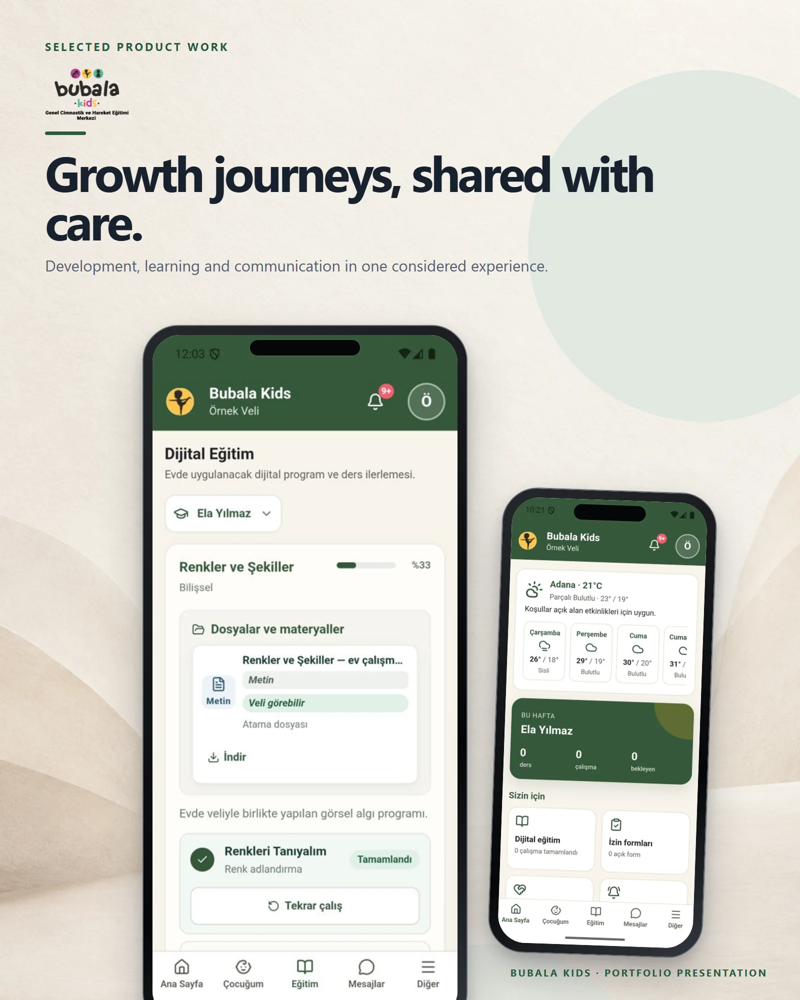

# Bubala Kids

A child development platform where parents, teachers and coordinators follow each child's assessments, goals, sessions and progress reports.

**Live:** [bubalakidsapp.com](https://bubalakidsapp.com) &nbsp;·&nbsp; **More work:** [github.com/mertomeroglu](https://github.com/mertomeroglu)

### Highlights

- Separate workspaces for parents, teachers and management
- Assessments with three main and two support goals per child
- 20-session program periods, attendance and approved progress reports
- Digital programs, materials, messaging and notifications
- Capacitor mobile app with Keystore / Keychain token storage and an offline outbox

### Built with

React · Vite · TypeScript · Fastify · PostgreSQL · Capacitor · Docker · Vitest

---

Presentation-only repository: this README and two presentation images built from real product screens. Application source and private configuration are not published here. Visual content and brand assets remain the property of their respective owners — see [LICENSE](LICENSE).
