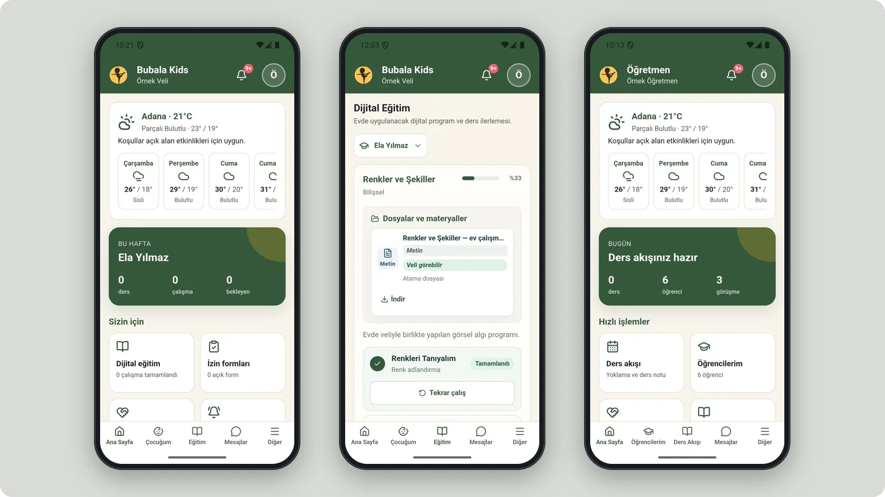
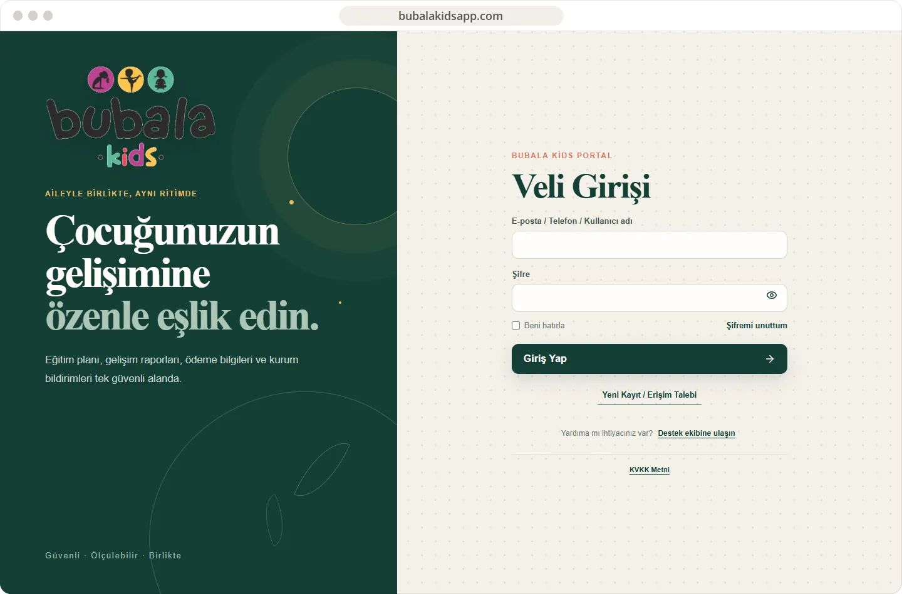

# Bubala Kids

A child development platform where parents, teachers and coordinators follow each child's assessments, goals, sessions and progress reports.

**[Visit bubalakidsapp.com ↗︎](https://bubalakidsapp.com)** &nbsp;·&nbsp; [More work by Mert Ömeroğlu](https://github.com/mertomeroglu)

### Highlights

- Separate workspaces for parents, teachers and management
- Assessments with three main and two support goals per child
- 20-session program periods, attendance and approved progress reports
- Digital programs, materials, messaging and notifications
- Capacitor mobile app with Keystore / Keychain token storage and an offline outbox

### Built with

React · Vite · TypeScript · Fastify · PostgreSQL · Capacitor · Docker · Vitest

### Screens

---

Presentation-only repository. Images are real, unmodified product screens in a simple frame; application source and private configuration are not published here. Brands and visual content belong to their respective owners — see [LICENSE](LICENSE).
